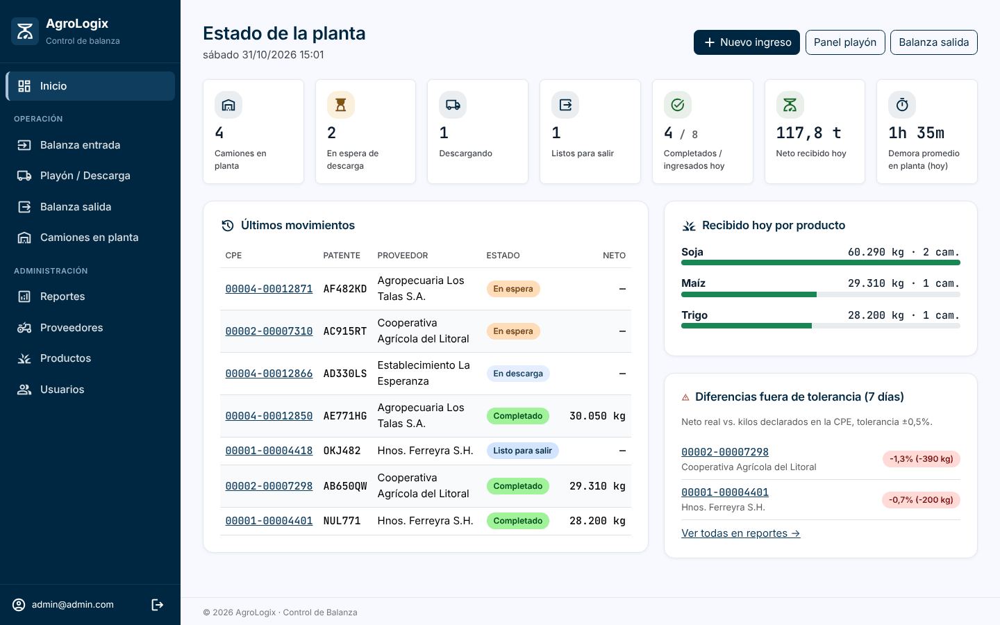
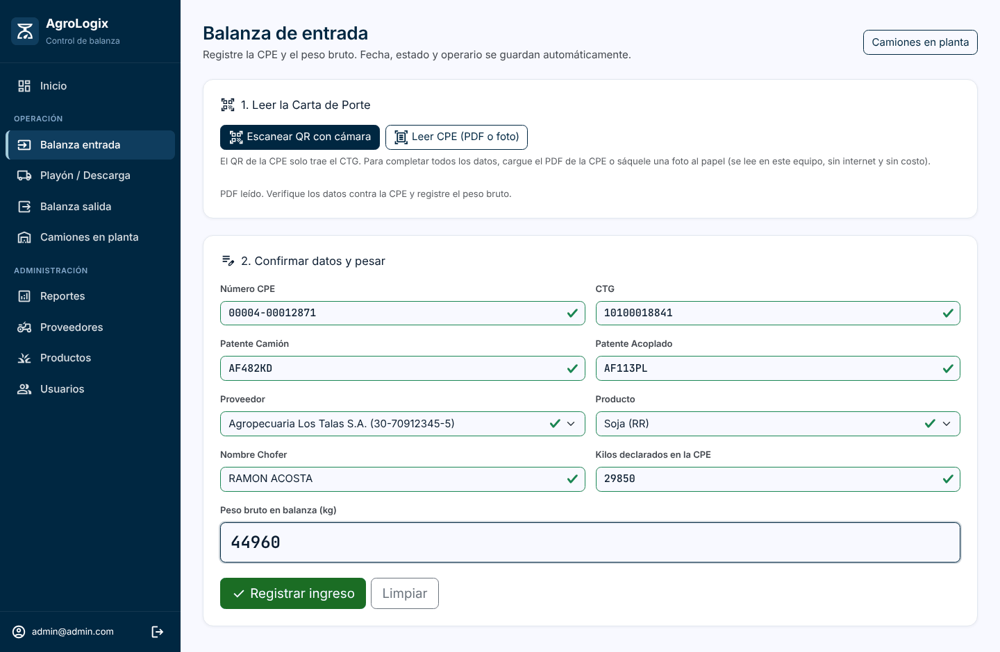
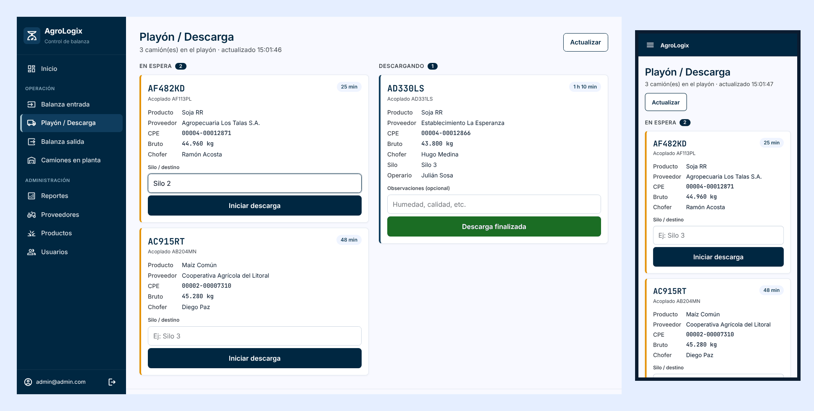
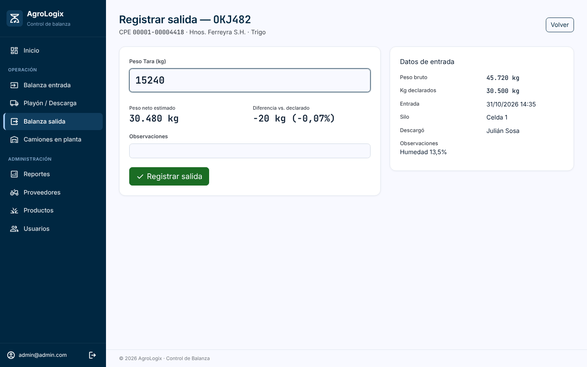
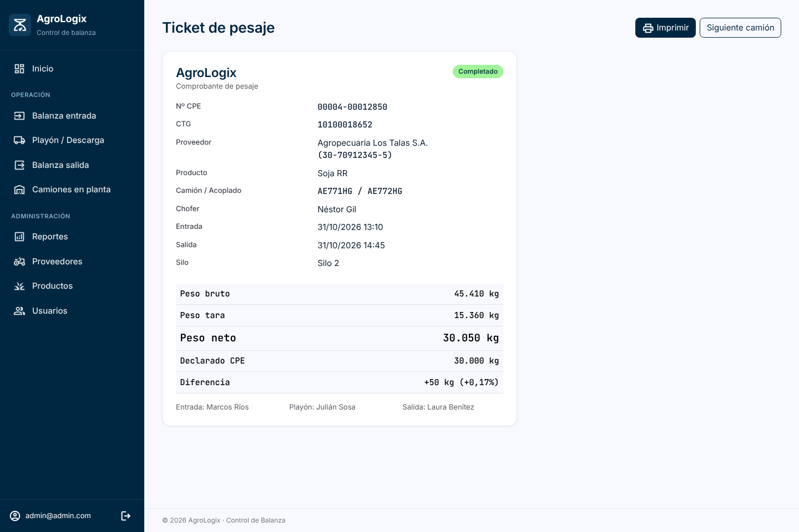
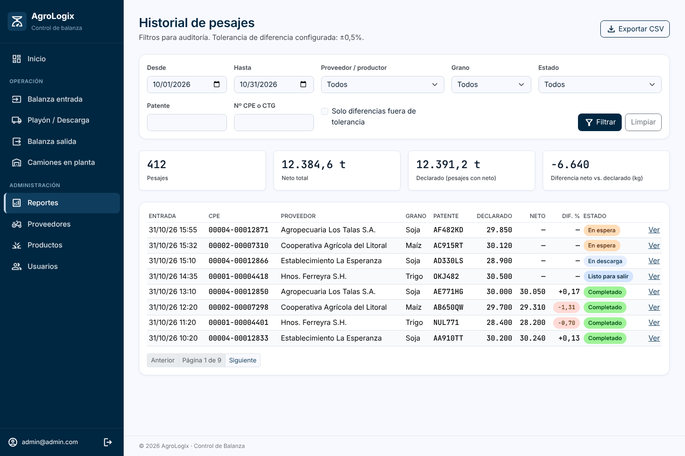
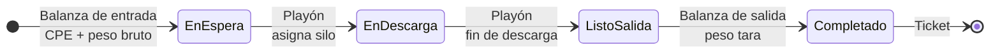

# AgroLogix · Control de Balanza y Cartas de Porte

Sistema web para la **recepción de camiones de granos** en acopios, molinos y plantas: lee la Carta de Porte Electrónica (CPE), registra el pesaje de entrada y salida, coordina la descarga en el playón y controla la diferencia entre lo declarado y lo realmente recibido.

Pensado para **zonas rurales con mala conectividad**: la CPE se lee por QR, desde su PDF o con OCR de una foto, todo en el propio equipo, **sin internet y sin servicios pagos**.




---

## Contenido

- [Capturas](#capturas)
- [Cómo funciona](#cómo-funciona)
- [Características](#características)
- [Lectura de la Carta de Porte](#lectura-de-la-carta-de-porte)
- [Stack](#stack)
- [Puesta en marcha](#puesta-en-marcha)
- [Configuración](#configuración)
- [Estructura del proyecto](#estructura-del-proyecto)
- [Próximos pasos](#próximos-pasos)

---

## Capturas

### Balanza de entrada: lectura automática de la CPE
Se carga el PDF de la CPE (o una foto del papel) y el formulario se completa solo: número de CPE, CTG, patentes, proveedor por CUIT, grano, chofer y kilos declarados. El operario confirma y registra el peso bruto.



### Playón / Descarga (Angular, pensado para celular)
Los operarios del playón ven los camiones en espera y descargando, asignan silo y registran observaciones. Se actualiza solo cada 15 segundos.



### Balanza de salida
Al cargar la tara se calcula en vivo el peso neto y la diferencia contra lo declarado en la CPE.



### Ticket de pesaje
Comprobante imprimible con pesos, diferencia y los operarios de cada etapa.



### Reportes y auditoría
Historial con filtros por fecha, productor, grano, patente, CPE/CTG y estado, alertas de diferencia fuera de tolerancia y exportación a CSV para Excel.



---

## Cómo funciona

Cada camión pasa por tres puestos, y cada puesto lo opera un rol distinto:



Todas las transiciones pasan por un único servicio (`Services/PesajeWorkflowService.cs`) que valida el estado actual y registra **qué usuario hizo cada etapa y cuándo**. El peso neto lo calcula SQL Server (columna calculada `PesoBruto - PesoTara`).

| Rol | Qué puede hacer |
|---|---|
| `BalanzaEntrada` | Leer la CPE y registrar el ingreso con el peso bruto |
| `Playon` | Panel del playón: iniciar y finalizar descargas |
| `BalanzaSalida` | Registrar la tara e imprimir el ticket |
| `Admin` | Todo lo anterior, más reportes, correcciones, proveedores, productos y usuarios |

Todos los usuarios ven el dashboard y los camiones en planta. No hay registro público: los usuarios los da de alta un administrador.

---

## Características

- **Lectura de la CPE sin costo:** QR, PDF o foto, procesado en el navegador (detalle abajo).
- **Flujo por roles:** cada operario ve solo sus pantallas; el menú se adapta al rol.
- **Panel del playón en Angular**, integrado dentro de una vista Razor y pensado para usarse desde el celular.
- **Dashboard** con camiones en planta por estado, ingresos y neto del día, demora promedio, recibido por grano y alertas.
- **Control de diferencias:** neto real vs. kilos declarados en la CPE, con tolerancia configurable.
- **Validaciones de negocio:**
  - CUIT con dígito verificador, patentes AAA999 / AA999AA, CTG.
  - CPE y CTG únicos; un camión no puede estar dos veces en planta.
  - Tara menor que bruto y tope de peso para detectar errores de tipeo.
  - Avisos de CPE vencida, destino a otra planta y CTG del QR distinto del impreso.
- **Reportes** con filtros, paginado y exportación a CSV.
- **Administración** de usuarios (alta, roles, desactivación, reseteo de contraseña), proveedores y productos. No se pueden borrar proveedores o productos con historial.
- **Funciona sin internet:** fuentes, íconos, OCR y librerías se sirven desde el propio sitio.
- **Formato argentino** en fechas y números, e interfaz en español (incluido el login).

---

## Lectura de la Carta de Porte

Probado con CPE reales de ARCA. Todo corre en el navegador del operario:

| Fuente | Qué se obtiene | Tiempo aprox. |
|---|---|---|
| **QR** (cámara) | Solo el **CTG**: el QR de la CPE no trae otros datos. | instantáneo |
| **PDF original de ARCA** | Todos los datos, leyendo el texto del PDF (exacto, sin OCR). | < 1 s |
| **PDF escaneado o foto** | Todos los datos por OCR (Tesseract.js, español). | 5-6 s |

Al leer un PDF o una foto también se busca el QR y se **cruza el CTG del QR con el impreso**, para detectar documentos inconsistentes. El proveedor se identifica por CUIT y el grano por nombre; si algo no se pudo leer o no cierra (CUIT inválido, pesos que no suman, patente dudosa por OCR), se muestra un aviso y el operario corrige antes de registrar.

La interpretación del texto está en `Services/Cpe/CpeTextoParser.cs` y los controles contra la base en `Services/Cpe/CpeIngresoService.cs`.

---

## Stack

| Capa | Tecnología |
|---|---|
| Backend | .NET 10, ASP.NET Core MVC, Identity con roles |
| Datos | SQL Server, Entity Framework Core (Code First, migraciones) |
| Frontend | Razor Views + Bootstrap 5.3; Angular 21 (signals, standalone) para el panel del playón |
| Lectura de CPE | html5-qrcode (QR), pdf.js (texto del PDF), Tesseract.js (OCR) |
| Tests | Vitest (Angular) |

---

## Puesta en marcha

**Requisitos:** .NET 10 SDK, SQL Server (Express alcanza) y Visual Studio 2022/2026. Node.js solo hace falta para modificar el panel Angular.

1. Clonar el repositorio.
2. Revisar la cadena de conexión en `SolucionesAgro/ControlBalanza/appsettings.json` (`ConnectionStrings:DbConnection`).
3. Abrir `SolucionesAgro/SolucionesAgro.slnx` en Visual Studio y presionar **F5**. Al arrancar se aplican las migraciones y se crean los roles y datos iniciales.
4. Ingresar con `admin@admin.com` / `Admin123`.

En entorno **Development** se crean además usuarios de prueba, uno por rol (contraseña `Agro1234`): `entrada@agro.local`, `playon@agro.local` y `salida@agro.local`. Con varias pestañas se puede recorrer el circuito completo de un camión.

> La cámara para leer el QR solo funciona con **HTTPS** (o `localhost`): usar el perfil `https` de `launchSettings.json`.

### Modificar el panel Angular

El sitio ya incluye el panel compilado en `wwwroot/angular-app`. Si se cambia el código de `ClientApp`, en una terminal en `SolucionesAgro\ControlBalanza\ClientApp`:

```powershell
npm install      # la primera vez o si cambia package.json
npm run build    # compila a ..\wwwroot\angular-app
npm test         # tests del panel
```

---

## Configuración

Sección `Balanza` de `appsettings.json`:

| Clave | Por defecto | Descripción |
|---|---|---|
| `ToleranciaDiferenciaPorcentaje` | `0.5` | Diferencia máxima (%) entre el neto real y lo declarado en la CPE antes de marcar alerta. |
| `PesoMaximoKg` | `75000` | Tope del peso bruto, para detectar errores de tipeo. |
| `NumeroPlantaRuca` | `null` | N° de planta (RUCA) en ARCA. Si se carga, se avisa cuando una CPE tiene como destino otra planta. |

---

## Estructura del proyecto

```text
SolucionesAgro/ControlBalanza/
├─ Controllers/             Pesajes, Reportes, Usuarios, Proveedores, Productos, Home
│  └─ Api/PlayonController.cs   API JSON del panel del playón (cookie + antiforgery)
├─ Services/                Flujo de estados, reportes
│  └─ Cpe/                  Lectura de la CPE: QR, texto (PDF/OCR) y controles
├─ Validacion/              CUIT, patentes y CTG
├─ Seguridad/Roles.cs       Roles del sistema
├─ Areas/Identity/          Login y acceso denegado en español
├─ Models/ · ViewModels/    Entidades y modelos de las vistas
├─ Migrations/              Migraciones de EF Core
├─ Views/                   Vistas Razor
├─ ClientApp/               Código fuente Angular (panel del playón)
└─ wwwroot/                 Estáticos: CSS, JS, build de Angular, fuentes y librerías
```

---

## Próximos pasos

- **Integración con el web service de ARCA (WSCPE):** con el CTG del QR, consultar los datos oficiales de la CPE (`consultarCPEAutomotor`) y confirmar el arribo y la descarga con los pesos reales (`confirmarArriboCPE`, `confirmacionDefinitivaCPEAutomotor`). Requiere el certificado digital del CUIT de la planta.
- Tests automatizados del backend (flujo de estados y parser de la CPE).
- Conexión directa con el indicador de la balanza para leer el peso sin tipearlo.

---

Desarrollado por [Rodrigo Bombieri](https://github.com/RodrigoBombieri).
